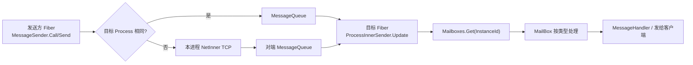

# Actor 在游戏服里是什么

ET 里的 Actor **不是** 一条独立线程，也不是 Unity 那种挂在物体上的脚本。它是：**挂了邮箱（`MailBoxComponent`）的 Entity，可以用 `ActorId` 跨 Fiber / 跨进程收发消息，而不直接拿对方引用。**

各服怎么连，见 [各服关系.md](./各服关系.md)。消息怎么进循环，见 [服务器启动与主循环.md](./服务器启动与主循环.md)。

## 先看结论

| 问题 | 答案 |
|------|------|
| Actor 是什么 | 带 `MailBoxComponent` 的 Entity（场景 Root、Player、Unit、GateSession 等） |
| 干什么 | 把“找对象、调方法”换成“按地址投递消息”，好拆服、好过线程边界 |
| 地址 | `ActorId = Process : Fiber : InstanceId` |
| 谁在跑消息 | 仍是该 Fiber 的 `Update`：从 `MessageQueue` 取出，丢进邮箱，再进 Handler |
| 找不到人怎么办 | 已知地址用 `MessageSender`；人会搬家（传送）用 Location：`entityId → ActorId` |

框架注释写得很直白：

```37:39:Server/Core/Core/Fiber/MailBoxComponent.cs
    /// <summary>
    /// 挂上这个组件表示该Entity是一个Actor,接收的消息将会队列处理
    /// </summary>
```

没有邮箱的 Entity 就只是普通组件树节点，别的 Fiber **不许**拿它的引用。



## 1. 定位：跨逻辑世界的邮递地址

服务器按 Fiber 切开（Realm、Gate、Map 各一个逻辑世界，还可能在不同 OS 线程上）。规则是：

- **禁止** `mapFiber.GetComponent<UnitComponent>().Get(id)` 这种跨 Fiber 直取
- **允许** `MessageSender.Call(actorId, msg)` 把消息扔进对方邮箱

所以 Actor 解决的是：

1. **线程隔离**：ThreadPool 上 Fiber 可能换线程，共享 Entity 会数据竞争
2. **进程隔离**：拆成多个 `App.dll` 后没有共享内存，只能按 `ActorId.Process` 走 NetInner
3. **对象搬家**：Unit 从 Map1 传到 Map2，旧引用作废；Location 把 `unitId` 改写成新 `ActorId`，发送方不用知道人在哪张图

它不是玩法对象模型本身。Player / Unit 仍是 Entity；**邮箱只是让它们能被远程叫到。**

## 2. ActorId 三截分别是什么

```74:113:Server/Core/Core/World/ActorId.cs
        public Address Address;   // Process + Fiber
        public long InstanceId;
        ...
        public ActorId(int process, int fiber, long instanceId)
```

Entity 取自己地址：

```9:13:Server/Core/Core/Fiber/Fiber.cs
        public static ActorId GetActorId(this Entity self)
        {
            Fiber root = self.Fiber();
            return new ActorId(root.Process, root.Id, self.InstanceId);
        }
```

| 字段 | 含义 |
|------|------|
| `Process` | 哪个 `App.dll`（`Options.Process`） |
| `Fiber` | 该进程里哪条 Fiber（常等于 `StartSceneConfig.Id`） |
| `InstanceId` | 这个 Entity 的实例号，在该 Fiber 的 `Mailboxes` 字典里当 key |

场景 Root 的 `InstanceId` 约定为 `1`，所以表里的 `StartSceneConfig.ActorId` 就是「这张图 / 这个 Gate 的场景 Actor」。对场景发 `R2G_GetLoginKey`、`M2M_UnitTransferRequest`，目标都是 Root，不是某个 Unit。

对 Unit / Player 发消息时，第三截必须是 **那个实体的 InstanceId**。邮箱 Awake 时按 `Parent.InstanceId` 登记，Destroy 时摘掉。

## 3. 一条 Actor 消息怎么走完

1. **发出**：`MessageSender.Send/Call(actorId, msg)`  
   - 同进程 → `ProcessInnerSender` → `MessageQueue.Send`  
   - 跨进程 → 先丢给本进程 `NetInner` Fiber，TCP 到对端再进队列
2. **进队**：`MessageQueue` 按 **目标 FiberId** 分队列（进程级单例，线程安全）
3. **取出**：目标 Fiber 每帧 `ProcessInnerSender.Update` 最多取 1000 条
4. **投递**：`Mailboxes.Get(actorId.InstanceId)` 找到邮箱；找不到则 `ERR_NotFoundActor`
5. **处理**：按 `MailBoxType` Invoke，再进 `MessageHandler` / `MessageLocationHandler`

`Call` 是 RPC：带 `RpcId`，对端 Handler 跑完自动 Reply；超时约 Actor 发送超时，RPC 超过 200ms 会打警告。`Send` 只投递不返回。

内网协议号在 `20000+`（如 `R2G_GetLoginKey`）。客户端 `C2M_*` 先进 Gate 外网，再被翻译成 Location Actor 消息。

## 4. 两种寻址

### 4.1 地址已知：直发 ActorId

适合目标不会搬家的场景 Actor：Realm 调 Gate、Gate 把 Unit 传到 `Map1` 的 Root。

```csharp
await root.GetComponent<MessageSender>().Call(startSceneConfig.ActorId, request);
```

### 4.2 地址会变：Location

Location Fiber 保存 `LocationType + key → ActorId`。发送方只知道 `playerId` / `unitId`：

```csharp
MessageLocationSenderComponent.Get(LocationType.Unit).Send(unitId, msg);
```

内部先查 Location（或用缓存的 proxy），再 `MessageSender` 打到当前 `ActorId`。传送时 `Lock` → 迁实体 → `UnLock` 换成新地址，避免迁徙窗口打到旧 Fiber。

当前类型：`Unit`、`Player`、`GateSession`（还有 Friend/Chat 预留）。Map 回客户端走 `LocationType.GateSession`，落到 Gate 上挂了 `MailBoxType.GateSession` 的组件，再 `Session.Send`。

## 5. 邮箱类型：消息到了怎么处理

| `MailBoxType` | 行为 | 谁在用 |
|---------------|------|--------|
| `UnOrderedMessage` | 立刻丢给 Handler，不排队互斥 | 场景 Root、Player |
| `OrderedMessage` | 按 ParentInstanceId 加协程锁，同一 Actor 消息串行 | Map 上的 Unit |
| `GateSession` | 不当作业务 Handler，直接 `Session.Send` 出网 | `PlayerSessionComponent` |

Unit 用有序邮箱，是避免同一玩家移动、切图、掉线交错把状态打乱。场景 Root 用无序，登录 Key、进图传送可以并行进 Handler。

## 6. 仓库里谁是 Actor

| Entity | 何时挂邮箱 | 别人怎么找到它 |
|--------|------------|----------------|
| 各场景 Root | `FiberInit_*` | `StartSceneConfig.ActorId`（InstanceId=1） |
| `Player` | `C2G_LoginGate` | Location `Player` |
| `PlayerSessionComponent` | 同上 | Location `GateSession`（下行出口） |
| `Unit` | 传到 Map 后 `M2M_UnitTransferRequestHandler` | Location `Unit`；客户端 `C2M_*` 经 Gate 转发 |

登录例子：Realm 并不连 Gate 的 WebSocket，而是 `Call(gateConfig.ActorId, R2G_GetLoginKey)`，消息进 Gate Root 的无序邮箱，`R2G_GetLoginKeyHandler` 执行。

进图后玩法：客户端 `C2M_TransferMap`（`ILocationRequest`）→ Gate 用 PlayerId 当 UnitId → Location 找到 Map 上的 Unit → Unit 的有序邮箱 → `C2M_TransferMapHandler`。

## 7. 和「每帧 Update」的关系

Actor **不替代** 主循环。定时器、AOI、收 WebSocket 仍是 `IUpdate`。Actor 管的是 **一次请求/通知**：谁在另一条 Fiber 上，把活递过去。

同一 Fiber 内部也可以 Actor Call（客户端 Main → NetClient 就是），多数时候同 Fiber 直接拿组件更简单；跨 Fiber 才必须走邮箱。

## 8. 写业务时怎么用

- 给需要被远程调用的 Entity `AddComponent<MailBoxComponent, MailBoxType>(...)`，需要搬家再 `AddLocation`
- Handler 用 `[MessageHandler(SceneType.X)]` 打场景 Root，或 `[MessageLocationHandler]` 打 Unit/Player
- 发消息用 `MessageSender` 或 `MessageLocationSenderComponent`，不要存其它 Fiber 的 Entity
- 传送、顶号要处理 `ERR_NotFoundActor` 和 Location 锁
- 不要给每个子弹都挂邮箱；高频模拟放在本 Fiber 的 `IUpdate` 上，邮箱留给「跨界」的命令
