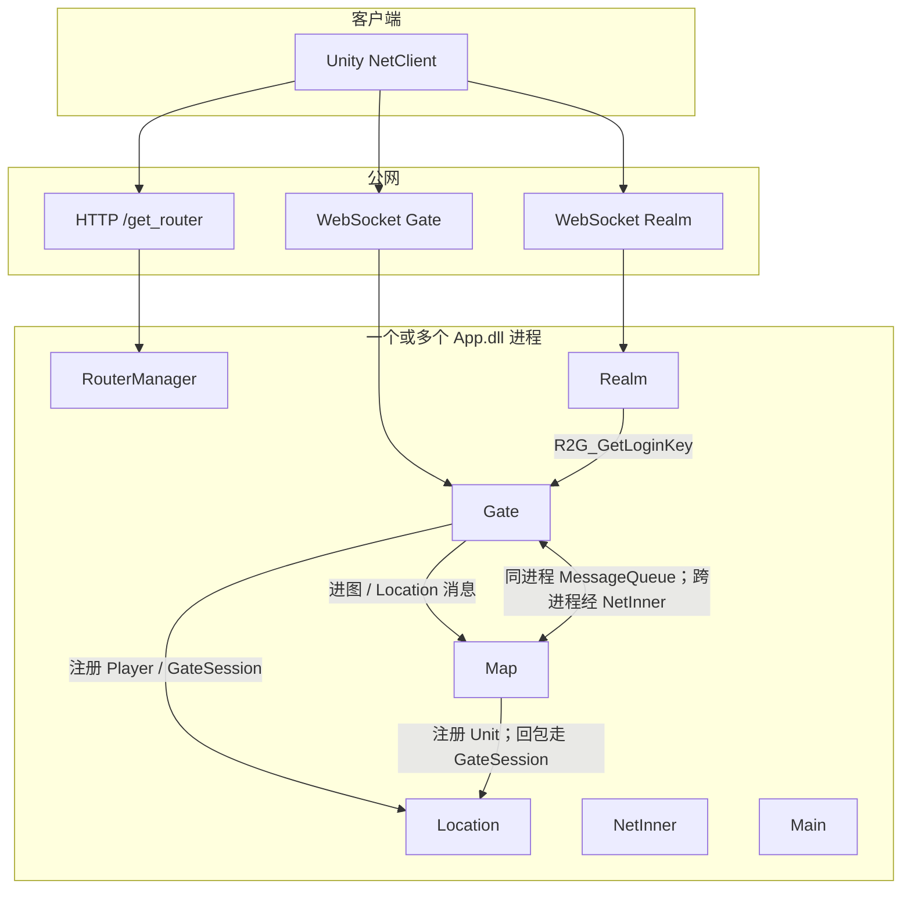

# 各服关系：Realm、Gate、Map 等

本文说明 GameNetty（ET 8）里各种「服」是什么、谁连谁、消息怎么走。它们多数不是独立可执行文件，而是 **同一进程里不同 `SceneType` 的 Fiber**；也可以按 `StartProcessConfig` 拆到多台机器、多个 `App.dll`。

相关文档：[服务器启动与主循环.md](./服务器启动与主循环.md)、[游戏主体逻辑循环.md](./游戏主体逻辑循环.md)、[登录流程.md](./登录流程.md)。

## 先看结论

| 名字 | 面向谁 | 干什么 | 当前默认端口（Localhost） |
|------|--------|--------|---------------------------|
| Watcher | 运维 / 本机 | 按机器配置拉起多个 Server 进程 | 无对外游戏口 |
| Main | 进程内部 | 启动编排；可选控制台 | 无 |
| NetInner | 其它进程 | 进程间 Actor 的 TCP 中转 | `:20001` |
| RouterManager | 客户端 HTTP | 发现 Realm / Router 地址 | `:30300` `/get_router` |
| Router | 客户端 KCP/UDP（ET 原路径） | 外网转发到内网 | 本仓库登录走 WebSocket，一般不经过它 |
| Realm | 客户端 WebSocket | 账号登录，分配 Gate，发一次性 Key | `:30002` |
| Gate | 客户端 WebSocket | 会话、在线 Player；之后所有外网包的入口 | `:30003` 等 |
| Location | 其它 Fiber | 按 Id 查 Actor 现在在哪个 Fiber | 无外网口 |
| Map | 不直连客户端 | Unit、AOI、地图玩法 | 无外网口 |
| Match / Room | 其它 Fiber | 匹配、帧同步房间（骨架，多处注释） | 无 |

客户端长期只连 **Gate**。Realm 只在登录时碰一下；地图逻辑在 Map 上，靠 Gate 转发。



## 1. 先分清三层：机器、进程、Fiber

| 层 | 配置 | 含义 |
|----|------|------|
| 机器 | `StartMachineConfig` | InnerIP / OuterIP |
| 进程 | `StartProcessConfig`：`Id`、所属机器、内网端口 | 一个 `dotnet App.dll --Process=N` |
| 场景 Fiber | `StartSceneConfig`：`Id`、Process、Zone、SceneType、Name、Port | Realm / Gate / Map … |

`--Process=1` 启动时，`EntryEvent2` 只创建 **该 Process 下的** 场景。Localhost 常见配法是 **一个进程里塞齐** RouterManager、Realm、Gate、Location、Map。拆服时把不同 `StartSceneConfig.Process` 指到不同进程 Id，跨进程 Actor 才走 NetInner。

Fiber 的 `ActorId` 是 `(Process, FiberId, InstanceId)`。`MessageSender`：目标 `Process` 相同 → `ProcessInnerSender` / `MessageQueue`；不同 → 交给本进程 `NetInner`，TCP 打到对端进程。

Watcher（`AppType.Watcher`）不是游戏服：对照本机 IP 找到 `StartMachineConfig`，再把该机器上的每个 Process 拉成子进程。

## 2. 各服职责

### 2.1 Main

每个 Server 进程一个，`SchedulerType.Main`。`FiberInit_Main` 发 EntryEvent1/2/3：挂 Timer / 邮箱，再按表创建其它 Fiber。可选 `ConsoleComponent`。不对外听游戏端口。

### 2.2 NetInner

进程配了内网 `Port` 才创建（`ConstFiberId.NetInner`）。听 `StartProcessConfig` 的内网地址，把 **跨进程 Actor** 收进来再丢进目标 Fiber 的队列。单进程部署时 Realm↔Gate 仍走 `MessageQueue`，这条 TCP 几乎闲着，但客户端绝不连它。

### 2.3 RouterManager 与 Router

- **RouterManager**：HTTP，返回表里所有 Realm（InnerIP:Port）和 Router（OuterIP:Port）。客户端用它做服务发现。
- **Router**：ET 的 UDP/KCP 入口，把外网包转到内网。当前登录是 **WebSocket 直连 Realm/Gate**，Router 不在主路径上；云上仍可能为兼容保留端口。

### 2.4 Realm（登录服）

短连接。`C2R_Login` 后：

1. `RealmGateAddressHelper.GetGate(zone, account)`：同区 Gate 列表按账号哈希选一个（粘滞，同一账号尽量同一 Gate）
2. Actor `R2G_GetLoginKey` 向该 Gate 要 Key
3. 把 Gate 地址、Key、GateId 回给客户端，约 1 秒后关掉 Realm Session

Realm **不持有** 玩家长期状态，也不转发进图后的包。

### 2.5 Gate（网关）

玩家在线期间唯一的外网连接。

登录：`C2G_LoginGate` 校验 Key → 创建或复用 `Player` → Location 登记 `GateSession` 和 `Player`。

之后客户端包进 `NetComponentOnReadInvoker_Gate`：

| 消息接口 | Gate 做什么 |
|----------|-------------|
| `ISessionMessage` | 本 Gate 处理（进图 `C2G_EnterMap` 等） |
| `ILocationMessage` / `ILocationRequest` | 用 PlayerId 当 UnitId，经 Location 转到 **当前 Map 上的 Unit** |

下行：Map 不直连客户端，`MapMessageHelper.SendToClient` 按 `LocationType.GateSession` 把包打回 Gate，再 `session.Send`。

Gate 管 **会话 + 在线账号**；坐标、AOI、战斗在 Map。

### 2.6 Location（寻址）

全局（当前表里一份 `LocationConfig`）的 `key → ActorId`。常见类型：

- `Player`：账号实体在哪个 Gate
- `GateSession`：回包通道，Map → 该玩家的 Gate Session
- `Unit`：地图实体在哪张 Map（传送时 Lock → 迁 Unit → UnLock 成新 ActorId）

Gate、Map 只持有 `LocationProxyComponent`，真正的表在 Location Fiber。没有 Location，传送后客户端还按旧 Fiber 发包就会打空。

### 2.7 Map（地图 / 逻辑服）

无外网口。`UnitComponent` + `AOI`。玩家进图：Gate 建 Unit，`TransferHelper` 发到 `GetBySceneName(zone, "Map1")` 的 Map Fiber。切图 `C2M_TransferMap` 在两张 Map 间再传一次（示例 Map1↔Map2）。

同一 Zone 可以多张 Map（多个 Fiber）。Unit **同时只活在一张 Map 上**。

### 2.8 其它

| 类型 | 状态 |
|------|------|
| Match / Room / RoomRoot / LockStep* | 枚举和部分 FiberInit 在，匹配组件多处注释 |
| Robot | 压测机器人 Fiber |
| Benchmark* | 压测 |
| Http | 通用 HTTP 场景标记；RouterManager 自己挂了 `HttpComponent` |

## 3. 玩家一条路上经过谁

```text
发现     客户端 HTTP  → RouterManager
登录     客户端 WS    → Realm  --Actor--> Gate（发 Key）
进服     客户端 WS    → Gate（校验 Key，建 Player，写 Location）
进图     客户端       → Gate  --Actor--> Map（Unit 落图，写 Location.Unit）
玩法     客户端 C2M_* → Gate  --Location.Unit--> Map 上的 Unit
广播     Map          → Location.GateSession → Gate → 客户端
掉线     Gate         → Location 发 G2M_SessionDisconnect → Map 上的 Unit
切图     MapA         → Location 锁 Unit → MapB 解锁
```

Realm 在「进服」之后不再出现。Map 永远不暴露给客户端。

## 4. 通信方式对照

| 路径 | 载体 | 例子 |
|------|------|------|
| 客户端 ↔ Realm / Gate | WebSocket（另有 UDP `NetComponent`，登录不用） | `C2R_Login`、`C2G_EnterMap` |
| 客户端 ↔ RouterManager | HTTP | `/get_router` |
| 同进程 Fiber ↔ Fiber | `MessageQueue` + `ProcessInnerSender` | Realm→Gate、Gate→Map |
| 跨进程 Fiber ↔ Fiber | 本进程 NetInner TCP → 对端 NetInner | 拆进程后的同样 Actor |
| 按 Id 找人 | Location 上的 `ObjectGet/Add/Lock` | 转发 `ILocationMessage` |
| 禁止 | 直接拿另一个 Fiber 的 Entity 引用 | 多线程竞争 |

外网协议号约 `10000+`，内网 Actor 约 `20000+`。

## 5. 和 Zone 的关系

`StartSceneConfig.Zone` 是逻辑区。Gate 按 Zone 分组；`GetGate(zone, account)` 只在该区 Gate 里哈希。`GetBySceneName(zone, "Map1")` 进的是 **本区** 地图。Realm 可以服务多个区的发现，但登录 Session 带 Zone，分配 Gate 不会跨区。

多区 = 多套 Gate/Map（可同进程也可不同进程），Location 当前是全表一份，扩展多 Location 时要改 `GetLocationSceneId`。

## 6. 扩容时怎么拆

不必改循环，改启动表：

| 目标 | 做法 |
|------|------|
| 加 Gate | 同 Zone 再加一行 `SceneType=Gate`，Realm 哈希自动分流 |
| 加地图 | 加 `Map` 行；进图/切图按名字取 `ActorId` |
| 登录与玩法分离 | Realm、RouterManager 一个 Process；Gate+Map+Location 另一个，靠 NetInner |
| 地图独立扩容 | 每张大地图一个 Process，Unit 传送即跨进程 Actor |
| Location 单点 | 先保持一个 Location 进程，所有服连它 |

拆开后客户端仍然只连 Gate；只要 `ActorId.Process` 对，`MessageSender` 会改走 NetInner。

## 7. 一句话记忆

- **Realm**：门卫，验号，发 Gate 门票。  
- **Gate**：门房，长连接，所有外网进出。  
- **Map**：院子，人（Unit）和玩法在这里。  
- **Location**：门牌，告诉别人人现在在哪个院子、回信寄到哪间门房。  
- **NetInner**：楼与楼之间的电话线。  
- **RouterManager**：问路处。  
- **Main / Watcher**：开工和看门的人，不是玩法服。
