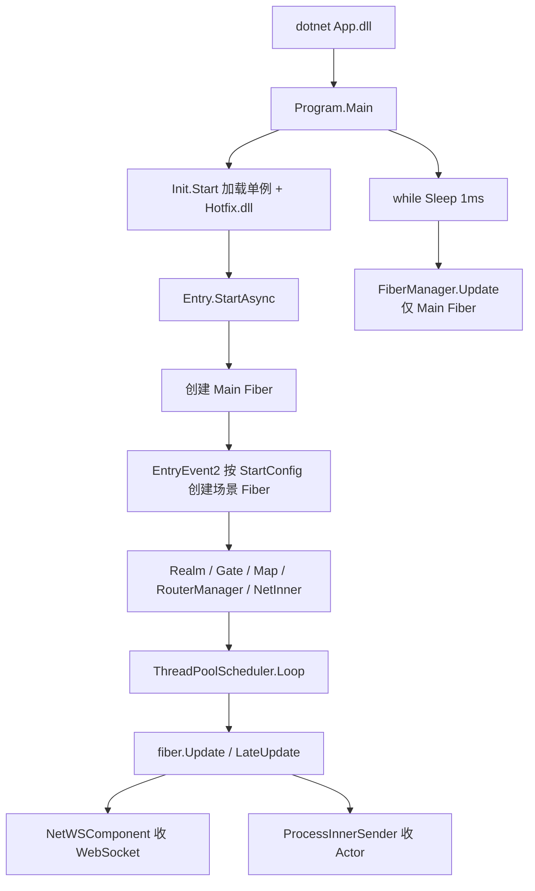

# 游戏服务器启动、初始化与主循环

本文对照当前仓库实现，说明 GameNetty（ET 8.1 风格）游戏服进程如何起来、各场景如何初始化、消息从哪里进来、以及“游戏主循环”实际落在哪几段代码。

客户端登录走 WebSocket 的路径见 [登录流程.md](./登录流程.md)。

## 先看结论

服务器没有 Unity 那种 `MonoBehaviour.Update`。进程自己转圈，每圈驱动 Fiber。

| 问题 | 答案 |
|------|------|
| 进程入口 | `Server/App/Program.cs` → `dotnet App.dll` |
| 进程主循环 | `Program.Main` 里 `while (true) { Sleep(1); init.Update(); }`，只驱动 **Main Fiber** |
| 游戏逻辑循环 | 每个 Fiber 的 `Fiber.Update` → `EntitySystem.Update` |
| Realm / Gate / Map | `ThreadPoolScheduler.Loop`，独立线程同样 `Sleep(1)` 转圈 |
| 听客户端 | `NetWSComponent.Update` → `WService.Update`（WebSocket） |
| 听内部 RPC | `ProcessInnerSender.Update` → `MessageQueue` |

没有单独的 `GameLoop.cs`。逻辑帧 = Fiber 的 Update 队列。玩法挂在哪个 Fiber、玩家何时进地图、全服活动往哪扩展，见 [游戏主体逻辑循环.md](./游戏主体逻辑循环.md)。Realm、Gate、Map、Location 等职责和连线见 [各服关系.md](./各服关系.md)。



## 1. 进程怎么跑起来

本地或 Docker 最终都执行 `App.dll`：

```text
dotnet App.dll --AppType=Server --Process=1 --StartConfig=StartConfig/Localhost --Console=0
```

容器入口是 `docker/entrypoint.sh` 里的 `exec dotnet App.dll "$@"`。`docker-compose.cvm.yml` 把上述参数传进去，并用 `ET_BIND_ANY` / `ET_OUTER_IP` 覆盖监听地址。

`Program.Main` 做三件事：静态 `Entry.Init()`、构造 `Init` 并 `Start()`，然后永远循环 `Update` / `LateUpdate`：

```8:27:Server/App/Program.cs
        public static void Main()
        {
            Entry.Init();
            
            Init init = new();
            init.Start();
            
            while (true)
            {
                Thread.Sleep(1);
                try
                {
                    init.Update();
                    init.LateUpdate();
                }
                catch (Exception e)
                {
                    Log.Error(e);
                }
            }
        }
```

这一圈大约 1ms 一次，是 **进程主线程循环**。它只驱动挂在 `SchedulerType.Main` 上的 Fiber（进程里的 Main 场景）。Realm / Gate / Map **不在** 这条 `while` 里跑。

`Init.Start` 解析命令行、挂 Logger / TimeInfo / FiberManager，最后加 `CodeLoader`。`CodeLoader.Awake` 读 `./Hotfix.dll`，再反射调用 `ET.Entry.Start`：

```9:30:Server/Loader/Init.cs
		public void Start()
		{
            ...
				World.Instance.AddSingleton<TimeInfo>();
				World.Instance.AddSingleton<FiberManager>();
				World.Instance.AddSingleton<CodeLoader>();
		}

		public void Update()
		{
			TimeInfo.Instance.Update();
			FiberManager.Instance.Update();
		}
```

```15:32:Server/Loader/CodeLoader.cs
        public void Awake()
        {
            ...
            Assembly hotfixAssembly = this.LoadHotfix(); // ./Hotfix.dll
            World.Instance.AddSingleton<CodeTypes, Assembly[]>(...);
            IStaticMethod start = new StaticMethod(this.assembly, "ET.Entry", "Start");
            start.Run();
        }
```

## 2. 初始化顺序

`Entry.StartAsync` 先把框架单例和 Luban 配置拉起来，再创建 **Main Fiber**：

```31:53:Server/Model/Model/Entry.cs
        private static async ETTask StartAsync()
        {
            WinPeriod.Init();
            MongoRegister.Init();
            EntitySerializeRegister.Init();
            World.Instance.AddSingleton<IdGenerater>();
            World.Instance.AddSingleton<OpcodeType>();
            ...
            await World.Instance.AddSingleton<ConfigLoader>().LoadAsync();
            await FiberManager.Instance.Create(SchedulerType.Main, ConstFiberId.Main, 0, SceneType.Main, "");
        }
```

创建 Fiber 时，在该 Fiber **自己的线程** 里按 `SceneType` 调用对应的 `FiberInit_*`：

```78:84:Server/Core/Core/World/Module/Fiber/FiberManager.cs
                fiber.ThreadSynchronizationContext.Post(async () =>
                {
                    await EventSystem.Instance.Invoke<FiberInit, ETTask>((long)sceneType, new FiberInit() {Fiber = fiber});
                    tcs.SetResult(true);
                });
```

Main Fiber 的 Init 连发三个事件（`FiberInit_Main`）：

1. **EntryEvent1**（`EntryEvent1_InitShare`）：Timer、协程锁、邮箱、`ProcessInnerSender`（进程内 Actor 队列）
2. **EntryEvent2**（`EntryEvent2_InitServer`）：按 `StartConfig` 再起一堆业务 Fiber
3. **EntryEvent3**：预留扩展

`AppType.Server` 时 EntryEvent2 会：

- 若进程配置了内网端口，创建 `NetInner` Fiber（进程间 TCP）
- 按 `StartSceneConfigCategory.GetByProcess(process)` 创建本进程所有场景（Realm、Gate、RouterManager、Map 等）

这些业务 Fiber 用的是 `SchedulerType.ThreadPool`。

每个场景自己的 `FiberInit_*` 才开始听端口。Realm 示例：

```17:19:Server/Hotfix/Demo/Realm/FiberInit_Realm.cs
            root.AddComponent<NetComponent, IPEndPoint, NetworkProtocol>(..., NetworkProtocol.UDP);
            root.AddComponent<NetWSComponent, IEnumerable<string>>(new[] { NetworkHelper.WebSocketPrefix(startSceneConfig.Port) });
```

`NetWSComponent.Awake` 里 `new WService(prefixs)`，HttpListener 接受 `ws://`。Gate 同样挂 `NetWSComponent`。RouterManager 挂 `HttpComponent` 听 `http://*:30300/`。

当前客户端登录用的是 WebSocket；Realm/Gate 上的 UDP `NetComponent` 这条路径不会走到。

## 3. 游戏主循环在哪

分两层。

### 3.1 进程主线程

就是上面的 `Program.Main` `while`。调用链：

```text
Init.Update
  → TimeInfo.Update
  → FiberManager.Update
       → MainThreadScheduler.Update
            → 取出 Main Fiber
            → fiber.Update()
Init.LateUpdate
  → FiberManager.LateUpdate
       → fiber.LateUpdate()
```

### 3.2 业务 Fiber 线程池

`ThreadPoolScheduler` 构造时按 CPU 核数 `new Thread(Loop)`。每个工作线程自己转圈：

```29:74:Server/Core/Core/World/Module/Fiber/ThreadPoolScheduler.cs
        private void Loop()
        {
            while (true)
            {
                ...
                fiber.Update();
                fiber.LateUpdate();
                this.idQueue.Enqueue(id);
            }
        }
```

每个 Fiber 一帧做的事：

```69:89:Server/Core/Core/Fiber/Fiber.cs
        internal void Update()
        {
            this.EntitySystem.Update();  // 所有 IUpdate 组件
        }
        
        internal void LateUpdate()
        {
            this.EntitySystem.LateUpdate();
            FrameFinishUpdate();
            this.ThreadSynchronizationContext.Update();  // 投递到本 Fiber 的异步回调
        }
```

`EntitySystem.Update` 扫描实现了 `IUpdate` 的组件，执行对应的 `[EntitySystem] Update`。和网络相关的两块每帧都会跑：

| 组件 | 每帧干什么 |
|------|------------|
| `NetWSComponent.Update` | `WService.Update()`：收 WebSocket 帧 |
| `ProcessInnerSender.Update` | 从 `MessageQueue` 取出 Actor 消息 |

Timer、AOI、移动等都是挂在某个 Entity 上的 `IUpdate`，同样在这一帧被扫到。

## 4. 消息怎么监听到 Handler

### 4.1 外网：客户端 WebSocket

```text
客户端 ws 发包
  → WService / WChannel 收帧
  → NetWSComponent.OnRead 反序列化
  → EventSystem.Invoke(SceneType, NetComponentOnRead)
  → NetComponentOnReadInvoker_Realm / Gate
  → MessageSessionDispatcher
  → C2R_LoginHandler / C2G_LoginGateHandler ...
```

```67:80:Server/Hotfix/Hotfix/Module/Message/NetWSComponentSystem_WebGL.cs
        private static void OnRead(this NetWSComponent self, long channelId, MemoryBuffer memoryBuffer)
        {
            ...
            (ActorId _, object message) = MessageSerializeHelper.ToMessage(self.AService, memoryBuffer);
            EventSystem.Instance.Invoke((long)self.IScene.SceneType, new NetComponentOnRead() {Session = session, Message = message});
        }
```

Realm 侧只处理 `ISessionMessage`，交给会话分发器：

```8:18:Server/Hotfix/Demo/Realm/NetComponentOnReadInvoker_Realm.cs
        public override void Handle(NetComponentOnRead args)
        {
            switch (message)
            {
                case ISessionMessage:
                    MessageSessionDispatcher.Instance.Handle(session, message);
```

Handler 用特性绑场景，例如 `[MessageSessionHandler(SceneType.Realm)]` 的 `C2R_LoginHandler`。`CodeLoader` 加载 Hotfix 时，`MessageSessionDispatcher` 会扫这些类型并注册。

### 4.2 进程内：Actor

Realm 向 Gate 要登录 Key 这类不走 WebSocket：

```text
MessageSender.Call(actorId, R2G_GetLoginKey)
  → 写入 MessageQueue
  → 目标 Fiber 的 ProcessInnerSender.Update 取出
  → MailBox → MessageHandler（如 R2G_GetLoginKeyHandler）
```

```26:35:Server/Hotfix/Hotfix/Module/Actor/ProcessInnerSenderSystem.cs
        private static void Update(this ProcessInnerSender self)
        {
            MessageQueue.Instance.Fetch(fiber.Id, 1000, self.list);
            foreach (MessageInfo actorMessageInfo in self.list)
            {
                self.HandleMessage(fiber, actorMessageInfo);
            }
        }
```

跨进程（多 `App.dll`）才走 NetInner 的 TCP；单进程 Localhost 配置下，Realm ↔ Gate 走同一进程的 `MessageQueue`。

## 5. Fiber 与调度对照

| Fiber | Scheduler | 谁驱动循环 | 主要监听 |
|-------|-----------|------------|----------|
| Main | `SchedulerType.Main` | `Program.Main` while | 控制台（可选）、启动编排 |
| NetInner | ThreadPool | `ThreadPoolScheduler.Loop` | 进程间 TCP `:20001` |
| Realm | ThreadPool | 同上 | WebSocket `:30002` |
| Gate | ThreadPool | 同上 | WebSocket `:30003` |
| RouterManager | ThreadPool | 同上 | HTTP `:30300` `/get_router` |
| Map 等 | ThreadPool | 同上 | 内网 Actor + 地图逻辑 |

`FiberManager.Create` 时把 fiberId 丢进对应 Scheduler 的队列；Scheduler 每圈取出、`Update`、再放回队尾。

## 6. 和客户端的对应关系

客户端 Unity 侧主循环在 `Init.Update` → `FiberManager.Update`（Unity 的 `MonoBehaviour.Update`）。服务器没有 Unity，所以用 `Program.Main` 的 `Sleep(1)` 模拟一帧。

登录时客户端 NetClient Fiber 连的是 Realm/Gate 的 `NetWSComponent`；服务端每帧 `WService.Update` 把包吐给上面第 4 节的 Handler。细节见 [登录流程.md](./登录流程.md)。
