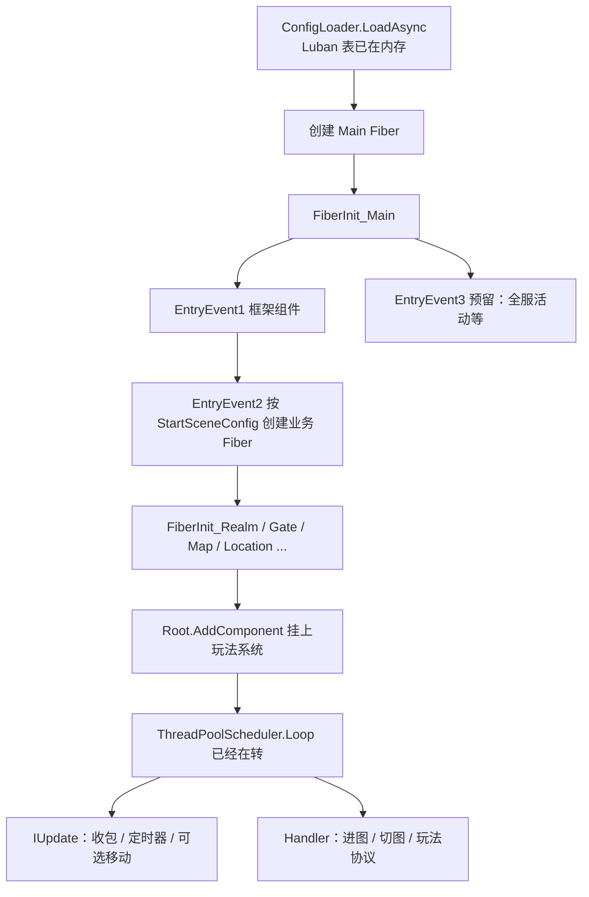

# 游戏主体逻辑从哪里开始转

进程起来、配置加载完之后，**没有**第二个 `StartGame()` / `GameLoop.cs` 再把“游戏”拉起来。调度器在 Fiber 一创建就已经在转；所谓主体逻辑，是往对应场景 Fiber 的 `Root` 上挂组件，再靠三种驱动跑起来：

1. **每帧 `IUpdate`**：网络收包、定时器扫描、AOI、移动等
2. **消息 Handler**：登录、进图、切图、玩家操作
3. **定时器回调**：按配置表开活动、周期结算等

进程如何起来、Main / ThreadPool 谁在 Sleep，见 [服务器启动与主循环.md](./服务器启动与主循环.md)。Realm / Gate / Map 等谁连谁，见 [各服关系.md](./各服关系.md)。本文只回答：**初始化之后，玩法落在哪、从哪挂、怎么转。**

## 先看结论

| 你想做的事 | 落点 | 当前仓库有没有 |
|------------|------|----------------|
| 循环本身（已经在转） | `ThreadPoolScheduler.Loop` → `Fiber.Update` → `EntitySystem.Update` | 有 |
| 按 `StartSceneConfig` 起 Realm / Gate / Map | `EntryEvent2_InitServer` | 有 |
| 地图里管 Unit、AOI | `FiberInit_Map` 挂 `UnitComponent` / `AOIManagerComponent` | 有（骨架） |
| 玩家进世界地图 | 客户端 `C2G_EnterMap` → Gate 建 Unit → 传到 Map Fiber | 有 |
| 按配置表开全服活动 | 应挂在 Main 的 `EntryEvent3`，或单独 Activity Fiber + `TimerComponent` | **还没有**，只有扩展点 |
| 玩家在线会话 | Gate 的 `PlayerComponent` | 有 |
| 玩家在地图上的实体 | Map 的 `UnitComponent` | 有 |

一句话：**服务主体不是“启动一个大循环”，而是“按配置起一堆 Fiber，每个 FiberInit 挂上自己的系统，调度器一直 Tick。”**



## 1. 循环在初始化之前就已经存在

`dotnet App.dll` 进 `Program.Main` 之后，主线程 `while` 只 Tick **Main Fiber**。`Entry.StartAsync` 里配置加载完成后创建 Main Fiber：

```50:52:Server/Model/Model/Entry.cs
            await World.Instance.AddSingleton<ConfigLoader>().LoadAsync();

            await FiberManager.Instance.Create(SchedulerType.Main, ConstFiberId.Main, 0, SceneType.Main, "");
```

`FiberManager.Create` 做两件事：

1. `schedulers[...].Add(fiberId)` —— **立刻进入调度队列**，下一圈就会 `Update`
2. 在该 Fiber 自己的上下文里 `Invoke<FiberInit>` —— 按 `SceneType` 找到 `FiberInit_*`

所以不是“Init 完再启动循环”，而是 **循环先转、Init 往上面挂肉**。业务 Fiber（Realm / Gate / Map）走 `SchedulerType.ThreadPool`，由 `ThreadPoolScheduler.Loop` 驱动，不在 `Program.Main` 那条 `while` 里。

## 2. 业务 Fiber 从哪张表拉起来

Main 的 `FiberInit_Main` 连发三个事件：

```10:12:Server/Hotfix/Hotfix/FiberInit_Main.cs
            await EventSystem.Instance.PublishAsync(root, new EntryEvent1());
            await EventSystem.Instance.PublishAsync(root, new EntryEvent2());
            await EventSystem.Instance.PublishAsync(root, new EntryEvent3());
```

| 事件 | 职责 | 实现 |
|------|------|------|
| `EntryEvent1` | 框架件：Timer、协程锁、邮箱、进程内 Actor | `EntryEvent1_InitShare` |
| `EntryEvent2` | **按进程配置创建玩法 Fiber** | `EntryEvent2_InitServer` |
| `EntryEvent3` | 预留，当前无 Handler | 适合挂全服级系统 |

`AppType.Server` 时 EntryEvent2：

1. 进程配了内网端口 → 创建 `NetInner` Fiber
2. `StartSceneConfigCategory.GetByProcess(process)` → 本进程所有场景各建一个 ThreadPool Fiber

```22:27:Server/Hotfix/Demo/EntryEvent2_InitServer.cs
                    var processScenes = StartSceneConfigCategory.Instance.GetByProcess(process);
                    foreach (StartSceneConfig startConfig in processScenes)
                    {
                        await FiberManager.Instance.Create(SchedulerType.ThreadPool, startConfig.Id, startConfig.Zone, startConfig.Type, startConfig.Name);
                    }
```

场景类型、区服、端口来自 Luban 的 `StartSceneConfig`（`Id / Process / Zone / SceneType / Name / Port`）。**开哪些地图、几个 Gate，改启动表，而不是改循环代码。**

## 3. 每个场景的“主体”在 FiberInit 里挂上

`[Invoke((long)SceneType.XXX)]` 的 `FiberInit_*` 就是该场景的构造函数。挂上的组件一旦实现 `IUpdate`，下一帧就会进 `EntitySystem` 的 Update 队列。

### 3.1 Map：世界地图与玩家实体

```11:20:Server/Hotfix/Demo/Map/FiberInit_Map.cs
            root.AddComponent<MailBoxComponent, MailBoxType>(MailBoxType.UnOrderedMessage);
            root.AddComponent<TimerComponent>();
            root.AddComponent<CoroutineLockComponent>();
            root.AddComponent<ProcessInnerSender>();
            root.AddComponent<MessageSender>();
            root.AddComponent<UnitComponent>();
            root.AddComponent<AOIManagerComponent>();
            root.AddComponent<LocationProxyComponent>();
            root.AddComponent<MessageLocationSenderComponent>();
```

这里就是当前“世界地图”的主体：

- `UnitComponent`：这张图上的玩家 / NPC 实体容器
- `AOIManagerComponent`：格子视野
- `TimerComponent`：这张图自己的定时器（Debuff、刷怪、延迟传送）
- `ProcessInnerSender`：每帧从 `MessageQueue` 取 Actor 消息（移动、切图、会话断开）

**服务器启动时 Map 是空的。** 玩家状态不是 Init 时种进去的，而是进图协议到达后创建 Unit。

### 3.2 Gate：会话与在线玩家

`FiberInit_Gate` 挂 `PlayerComponent`、`GateSessionKeyComponent`、外网 `NetWSComponent`。Gate 管的是 **账号会话**，不是地图坐标。进图时才把 Unit 转到 Map。

### 3.3 Realm / Location / Match

| Fiber | FiberInit 挂了什么 | 角色 |
|-------|-------------------|------|
| Realm | 网络 + 消息发送 | 登录入口 |
| Location | `LocationManagerComoponent` | Unit / Player 的 Actor 寻址 |
| Match | 消息骨架（`MatchComponent` 被注释） | 匹配，未启用 |
| NetInner | 进程间 TCP | 多进程才有用 |

## 4. 玩家是怎么进入地图循环的

进图是 **消息驱动**，不是启动时扫表刷人。

```text
客户端 C2G_EnterMap
  → Gate：C2G_EnterMapHandler
  → 临时 GateMap 上 UnitFactory.Create
  → TransferHelper 等本帧结束
  → M2M_UnitTransferRequest 打到 StartSceneConfig 里名为 Map1 的 Fiber
  → Map：M2M_UnitTransferRequestHandler
       反序列化 Unit，加入 UnitComponent
       设坐标、MailBox、AOI
       通知客户端创建自己的 Unit
       Location 解锁，之后 C2M_* 打到这个 Unit
```

关键代码：

```19:23:Server/Hotfix/Demo/Gate/C2G_EnterMapHandler.cs
			StartSceneConfig startSceneConfig = StartSceneConfigCategory.Instance.GetBySceneName(session.Zone(), "Map1");
			response.MyId = player.Id;
			TransferHelper.TransferAtFrameFinish(unit, startSceneConfig.ActorId, startSceneConfig.Name).Coroutine();
```

进图之后，这个玩家的后续逻辑都在 **Map Fiber** 上：

- 协议：`[MessageHandler(SceneType.Map)]` / Location 消息打到 Unit
- 位置变化：`ChangePosition_NotifyAOI` 更新格子、通知进出视野
- 切图：`C2M_TransferMapHandler` 再走一遍 Transfer
- 掉线：Gate `G2M_SessionDisconnect` → Map 上的 Unit Handler

当前 `MoveComponent` / 寻路在 Factory 和 Transfer Handler 里是注释掉的，地图循环主要是 **消息 + AOI**，还没有每帧积分移动。

## 5. 一帧里真正跑的是什么

任意 Fiber 被调度到时：

```text
fiber.Update()
  → EntitySystem.Update
       队列里所有 IUpdate 组件各跑一次
fiber.LateUpdate()
  → EntitySystem.LateUpdate
  → WaitFrameFinish 的任务（传送故意等到帧尾）
  → ThreadSynchronizationContext（await 回调回到本 Fiber）
```

当前服务端实现了 `IUpdate`、会每帧被扫到的，主要是：

| 组件 | 典型所在 Fiber | 每帧做什么 |
|------|----------------|------------|
| `ProcessInnerSender` | 几乎所有业务 Fiber | 取 Actor 消息，进邮箱 / Handler |
| `NetWSComponent` / `NetComponent` | Realm、Gate | 收外网包 |
| `TimerComponent` | 各 Fiber 自己一份 | 到期则 `TimerCallback` |
| `CoroutineLockComponent` | 各 Fiber | 超时解锁 |
| `RouterComponent` | Router | 转发 |

`UnitComponent`、`PlayerComponent`、`AOIManagerComponent` **没有** `IUpdate`。它们是容器，被 Handler / 事件改，不会自己每帧扫一遍所有玩家。需要每帧模拟（移动、Buff）时，给 Unit 加 `IUpdate` 组件，或用 `TimerComponent.NewRepeatedTimer`。

## 6. 全服活动应该挂在哪

仓库里 **没有** 活动表、也没有 `ActivityComponent`。配置在 `Entry.StartAsync` 里已经全部进内存，缺的是一个挂载点。推荐三种，按作用域选：

### 6.1 进程级 / 全区级（推荐先用这个）

在 `EntryEvent3` 写 Handler（`[Event(SceneType.Main)]`），在 Main Fiber 上 `AddComponent<ActivityComponent>()`：

- 读 Luban 活动表（开始/结束时间、开关）
- `TimerComponent.NewOnceTimer` / `NewRepeatedTimer` 到点开启、关闭、结算
- 需要通知各 Map 时，对 `StartSceneConfigCategory.Instance.Maps` 发 Actor 消息，不要直接拿别的 Fiber 引用

Main 由 `Program.Main` 的 `Sleep(1)` 驱动，语义接近“每毫秒一帧”，适合全服时钟，不适合海量单位模拟。

### 6.2 地图级

刷怪、场景天气、本地活动：在 `FiberInit_Map` 里挂组件。只影响这一张图上的 Unit。多 Map Fiber 就会有多份，不要把“全区唯一活动状态”放这里。

### 6.3 独立 Activity Fiber

活动很重、或要和 Map 隔离线程时：在 `StartSceneConfig` 加一行 `SceneType`（需扩展枚举 + `FiberInit_Activity`），EntryEvent2 会自动创建。循环仍然是 ThreadPool 的 `Loop`，没有新的启动函数。

无论哪种，**都不要再开一条 `while(true)`。** 用已有 `TimerComponent`（墙钟 `GetNow()`）对齐开闭时间，避免把“每次 Update”当成固定帧率。

## 7. 扩展时往哪写

| 需求 | 写哪里 |
|------|--------|
| 新场景类型 | `SceneType` 枚举 + `FiberInit_Xxx` + `StartSceneConfig` 一行 |
| 地图上每帧模拟 | Unit 或 Map Root 上实现 `IUpdate` 的组件 |
| 玩家操作 | `C2M_*` Handler，`SceneType.Map` 或 Location |
| 进图默认地图 | `C2G_EnterMapHandler` 里 `GetBySceneName(..., "Map1")` |
| 全服定时 | `EntryEvent3` + Main 上的 Timer |
| 跨图广播 | `MessageSender` / Location，禁止跨 Fiber 直接持有 Entity |

原则：一个 Fiber 一个逻辑世界；Unit 只活在某一个 Map Fiber 上；Gate 只保留 Player 会话；全服单例放 Main 或独立场景，用消息同步下去。
