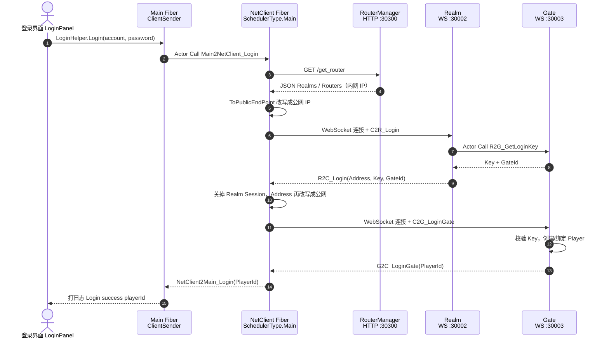
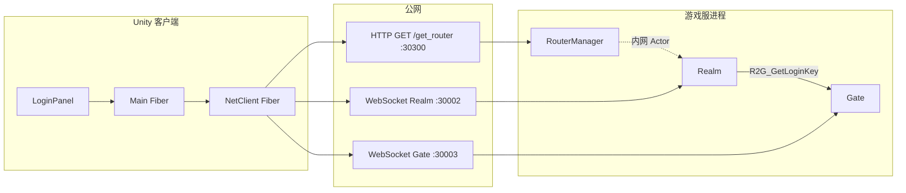

# 客户端登录流程

本文对照当前仓库实现，梳理 Unity 客户端从点击登录到拿到 `PlayerId` 的完整链路。交互时序图见同目录：

- 可交互图：[login-sequence.html](./login-flow/login-sequence.html)
- 图源：[login-flow/login-sequence.json](./login-flow/login-sequence.json)

当前部署约定：客户端 `ConstValue.RouterHttpHost` 指向云服务器公网 IP（例如 `81.70.28.46`），RouterManager HTTP 端口 `30300`，Realm / Gate 对外是 WebSocket（TCP `30002` / `30003`）。服务器进程如何启动、主循环和消息监听见 [服务器启动与主循环.md](./服务器启动与主循环.md)。各服职责与连线见 [各服关系.md](./各服关系.md)。

## 总览

登录分四段：本机 Actor 转发、HTTP 发现、WebSocket 登 Realm、WebSocket 进 Gate。Realm 与 Gate 之间走进程内 Actor（内网 TCP），客户端看不到这一段。





## 1. 客户端发起

玩家在登录界面点按钮，Unity 主线程把账号密码交给 ET 的 Main Fiber。

```20:23:Unity/Assets/GameScripts/GameLogic/UIDemo/LoginPanel.cs
    void OnClickLogin()
    {
        LoginHelper.Login(Init.Root,account.text,password.text).Coroutine();
    }
```

`LoginHelper` 重建 `ClientSenderComponent`，再 `await LoginAsync`。成功后目前只打日志；把 `PlayerId` 写入 `PlayerComponent`、发布 `LoginFinish` 的代码还是注释状态。

```5:18:Unity/Assets/GameScripts/GameLogic/NetClient/LoginHelper.cs
        public static async ETTask Login(Scene root, string account, string password)
        {
            root.RemoveComponent<ClientSenderComponent>();
            
            ClientSenderComponent clientSenderComponent = root.AddComponent<ClientSenderComponent>();
            
            long playerId = await clientSenderComponent.LoginAsync(account, password);
            
            Log.Info($"Login success playerId:{playerId}");
            // root.GetComponent<PlayerComponent>().MyId = playerId;
            // await EventSystem.Instance.PublishAsync(root, new LoginFinish());
```

`LoginAsync` 做两件事：

1. 创建 **NetClient Fiber**，调度器是 `SchedulerType.Main`（必须在 Unity 主线程，`UnityWebSocket` 才能 `GameObject.Find`）。
2. 通过 `ProcessInnerSender.Call` 把 `Main2NetClient_Login` 发到这条 Fiber，并等待 `NetClient2Main_Login`。

```39:49:Unity/Assets/GameScripts/GameLogic/NetClient/ClientSender/ClientSenderComponentSystem.cs
        public static async ETTask<long> LoginAsync(this ClientSenderComponent self, string account, string password)
        {
            self.fiberId = await FiberManager.Instance.Create(SchedulerType.Main, 0, SceneType.NetClient, "");
            self.netClientActorId = new ActorId(self.Fiber().Process, self.fiberId);

            Main2NetClient_Login main2NetClientLogin = Main2NetClient_Login.Create();
            main2NetClientLogin.OwnerFiberId = self.Fiber().Id;
            main2NetClientLogin.Account = account;
            main2NetClientLogin.Password = password;
            NetClient2Main_Login response = await self.Root().GetComponent<ProcessInnerSender>().Call(self.netClientActorId, main2NetClientLogin) as NetClient2Main_Login;
            return response.PlayerId;
        }
```

`Main2NetClient_Login` 字段：`OwnerFiberId`、`Account`、`Password`。回包 `NetClient2Main_Login` 字段：`Error`、`Message`、`PlayerId`。

## 2. NetClient：发现地址并改写公网 IP

真正的外网登录在 `Main2NetClient_LoginHandler` 里。

1. 清掉旧的 `RouterAddressComponent` / `NetWSComponent`。
2. HTTP 拉 Router / Realm 列表。
3. 创建 `NetWSComponent`（内部是 `WService` → `WChannel` → `ws://ip:port`）。
4. 按账号哈希挑一个 Realm，把 host 换成 `ConstValue.RouterHttpHost`，端口不变。

```18:28:Unity/Assets/GameScripts/GameLogic/NetClient/Main2NetClient_LoginHandler.cs
            Log.Info($"login http {ConstValue.RouterHttpHost}:{ConstValue.RouterHttpPort}");
            RouterAddressComponent routerAddressComponent =
                    root.AddComponent<RouterAddressComponent, string, int>(ConstValue.RouterHttpHost, ConstValue.RouterHttpPort);
            await routerAddressComponent.Init();
            // ...
            IPEndPoint innerRealm = routerAddressComponent.GetRealmAddress(account);
            IPEndPoint realmAddress = ToPublicEndPoint(innerRealm);
```

HTTP 请求：

```
GET http://{RouterHttpHost}:30300/get_router?v={随机数}
```

服务端 `HttpGetRouterHandler` 返回的 `Realms` 用的是 **InnerIP**（云上通常是 `127.0.0.1:30002`），`Routers` 才拼 OuterIP。客户端直连 Realm/Gate 时必须自己改写 host，否则会连到本机。

```13:22:Server/Hotfix/Demo/Router/HttpGetRouterHandler.cs
            foreach (StartSceneConfig startSceneConfig in StartSceneConfigCategory.Instance.Realms)
            {
                response.Realms.Add(startSceneConfig.InnerIPPort.ToString());
            }
            foreach (StartSceneConfig startSceneConfig in StartSceneConfigCategory.Instance.Routers)
            {
                response.Routers.Add($"{startSceneConfig.StartProcessConfig.OuterIP}:{startSceneConfig.Port}");
            }
```

## 3. 连 Realm：`C2R_Login`

`NetWSComponent.Create` 会立刻 `WChannel` 构造并 `ConnectAsync()`。Handler 里额外 `WaitAsync(300)`，给握手留一点时间，再 `session.Call(C2R_Login, 15000)`。

`C2R_Login` 带 `Account`、`Password`。Realm 处理：

```10:26:Server/Hotfix/Demo/Realm/C2R_LoginHandler.cs
		protected override async ETTask Run(Session session, C2R_Login request, R2C_Login response)
		{
			StartSceneConfig config = RealmGateAddressHelper.GetGate(session.Zone(), request.Account);
			R2G_GetLoginKey r2GGetLoginKey = R2G_GetLoginKey.Create();
			r2GGetLoginKey.Account = request.Account;
			G2R_GetLoginKey g2RGetLoginKey = (G2R_GetLoginKey) await session.Fiber().Root.GetComponent<MessageSender>().Call(
				config.ActorId, r2GGetLoginKey);

			response.Address = config.InnerIPPort.ToString();
			response.Key = g2RGetLoginKey.Key;
			response.GateId = g2RGetLoginKey.GateId;
			CloseSession(session).Coroutine();
		}
```

要点：

- 用账号哈希在本区 Gate 列表里挑一台（`RealmGateAddressHelper.GetGate`）。
- 向该 Gate **Actor 调用** `R2G_GetLoginKey`（进程内，不是 WebSocket）。
- 回给客户端的 `Address` 仍是 Gate 内网 `InnerIPPort`。
- 回包后约 1 秒关掉这次 Realm Session。Realm 只负责发通行证，不保持长连接。

Gate 侧生成一次性 Key：

```9:16:Server/Hotfix/Demo/Gate/R2G_GetLoginKeyHandler.cs
		protected override async ETTask Run(Scene scene, R2G_GetLoginKey request, G2R_GetLoginKey response)
		{
			long key = RandomGenerator.RandInt64();
			scene.GetComponent<GateSessionKeyComponent>().Add(key, request.Account);
			response.Key = key;
			response.GateId = scene.Id;
			await ETTask.CompletedTask;
		}
```

`R2C_Login` 回包字段：`Address`、`Key`、`GateId`。

## 4. 连 Gate：`C2G_LoginGate`

客户端关掉 Realm Session 后：

1. 把 `r2CLogin.Address` 再改写成公网 IP。
2. 新建 Gate WebSocket Session，挂上 `ClientSessionErrorComponent`，存进 `SessionComponent`（之后游戏消息走这条长连接）。
3. 发送 `C2G_LoginGate`（`Key` + `GateId`）。

Gate 处理：

```9:54:Server/Hotfix/Demo/Gate/C2G_LoginGateHandler.cs
            string account = root.GetComponent<GateSessionKeyComponent>().Get(request.Key);
            if (account == null)
            {
                response.Error = ErrorCore.ERR_ConnectGateKeyError;
                response.Message = "Gate key验证失败!";
                return;
            }
            // ...
            Player player = playerComponent.GetByAccount(account);
            if (player == null)
            {
                player = playerComponent.AddChild<Player, string>(account);
                // MailBox + Location：GateSession / Player
                session.AddComponent<SessionPlayerComponent>().Player = player;
                playerSessionComponent.Session = session;
            }
            else
            {
                player.GetComponent<PlayerSessionComponent>().Session = session;
            }
            response.PlayerId = player.Id;
```

Key 对不上就失败。新号会创建 `Player`，注册 MailBox 和 Location；老号则把 Session 绑到已有 Player（顶号）。回包 `G2C_LoginGate.PlayerId`。

## 5. 客户端接到数据之后

回包沿原路返回：

| 方向 | 消息 | 处理 |
|------|------|------|
| Gate → NetClient | `G2C_LoginGate` | `session.Call` 完成，写入 `response.PlayerId` |
| NetClient → Main | `NetClient2Main_Login` | `ProcessInnerSender` 结束这次 Actor Call |
| Main → UI | 无协议 | `LoginHelper` 打 `Login success playerId` |

当前登录成功后 **没有** 切场景、也没有发 `LoginFinish`。长连接已经在 `SessionComponent.Session` 上，之后业务请求走 `ClientSenderComponent.Call/Send`，由 NetClient 转到这条 Gate Session。

## 消息一览

| 消息 | 场景 | 通道 | 关键字段 |
|------|------|------|----------|
| `Main2NetClient_Login` | 客户端进程内 | Actor | Account, Password, OwnerFiberId |
| `GET /get_router` | RouterManager | HTTP | Realms[], Routers[] |
| `C2R_Login` | Realm | WebSocket | Account, Password |
| `R2G_GetLoginKey` | Realm → Gate | 内网 Actor | Account |
| `R2C_Login` | Realm → 客户端 | WebSocket | Address, Key, GateId |
| `C2G_LoginGate` | Gate | WebSocket | Key, GateId |
| `G2C_LoginGate` | Gate → 客户端 | WebSocket | PlayerId |
| `NetClient2Main_Login` | 客户端进程内 | Actor | PlayerId |

## 端口与线程

| 端口 | 协议 | 角色 |
|------|------|------|
| 30300 | HTTP | RouterManager，发现 Realm/Router |
| 30002 | WebSocket（TCP） | Realm 登录 |
| 30003 / 30004 | WebSocket（TCP） | Gate 进服与之后的游戏消息 |
| 20001 | TCP | 进程内网 NetInner（客户端不连） |

NetClient Fiber 必须 `SchedulerType.Main`。ThreadPool 上创建 WebSocket 会触发 Unity `Find can only be called from the main thread`，登录 Rpc 报 `110307`。
